# Diagrama de Clases UML y Fundamentos POO

**Proyecto**: Sistema de Gestión de Inventario y Ventas  
**Curso**: Programación Orientada a Objetos  
**Lenguaje**: Java 21 (Swing + Gson + FlatLaf)  
**Integrantes**:
* Pedro Andrés Chajón
* Sharon Guacamaya
* Dannii Pirir

---

## 1. Diagrama de Clases UML del Sistema

El diagrama modela la estructura de clases del proyecto dividida en sus paquetes principales: el dominio (`com.sistema.model`), la persistencia (`com.sistema.persistence`) y la lógica de negocio (`com.sistema.controller`).

```mermaid
classDiagram
    direction TB

    %% Jerarquia de Persona
    class Persona {
        <<abstract>>
        #String dpi
        #String nombre
        #String direccion
        +Persona()
        +Persona(String dpi, String nombre, String direccion)
        +getDpi() String
        +setDpi(String dpi) void
        +getNombre() String
        +setNombre(String nombre) void
        +getDireccion() String
        +setDireccion(String direccion) void
        +toString() String
    }

    class Cliente {
        -String fechaNacimiento
        -TipoCliente tipo
        +Cliente()
        +Cliente(String dpi, String nombre, String direccion, String fechaNacimiento, TipoCliente tipo)
        +getFechaNacimiento() String
        +setFechaNacimiento(String fechaNacimiento) void
        +getTipo() TipoCliente
        +setTipo(TipoCliente tipo) void
        +toString() String
    }

    class TipoCliente {
        <<enumeration>>
        REGULAR
        VIP
    }

    class Empleado {
        -String idEmpleado
        -String puesto
        -double salario
        +Empleado()
        +Empleado(String idEmpleado, String nombre, String dpi, String direccion, String puesto, double salario)
        +getIdEmpleado() String
        +setIdEmpleado(String idEmpleado) void
        +getPuesto() String
        +setPuesto(String puesto) void
        +getSalario() double
        +setSalario(double salario) void
        +toString() String
    }

    Persona <|-- Cliente : hereda
    Persona <|-- Empleado : hereda
    Cliente --> TipoCliente : tiene tipo

    %% Catalogo, Bodegas e Inventario
    class Producto {
        -String codigo
        -String nombre
        -String descripcion
        -String marca
        -double precio
        +Producto()
        +Producto(String codigo, String nombre, String descripcion, String marca, double precio)
        +getCodigo() String
        +setCodigo(String codigo) void
        +getNombre() String
        +setNombre(String nombre) void
        +getDescripcion() String
        +setDescripcion(String descripcion) void
        +getMarca() String
        +setMarca(String marca) void
        +getPrecio() double
        +setPrecio(double precio) void
        +toString() String
    }

    class Bodega {
        -String idBodega
        -String nombre
        -String direccion
        -int capacidad
        -Empleado encargado
        +Bodega()
        +Bodega(String idBodega, String nombre, String direccion, int capacidad, Empleado encargado)
        +getIdBodega() String
        +setIdBodega(String idBodega) void
        +getNombre() String
        +setNombre(String nombre) void
        +getDireccion() String
        +setDireccion(String direccion) void
        +getCapacidad() int
        +setCapacidad(int capacidad) void
        +getEncargado() Empleado
        +setEncargado(Empleado encargado) void
        +toString() String
    }

    class ItemInventario {
        -Producto producto
        -int stock
        +ItemInventario()
        +ItemInventario(Producto producto, int stock)
        +getProducto() Producto
        +setProducto(Producto producto) void
        +getStock() int
        +setStock(int stock) void
        +agregarStock(int cantidad) void
        +restarStock(int cantidad) boolean
        +toString() String
    }

    class Inventario {
        -String idBodega
        -List~ItemInventario~ items
        +Inventario()
        +Inventario(String idBodega)
        +getIdBodega() String
        +setIdBodega(String idBodega) void
        +getItems() List~ItemInventario~
        +setItems(List~ItemInventario~ items) void
        +registrarOActualizarStock(Producto producto, int cantidad) void
        +descontarStock(String codigoProducto, int cantidad) boolean
        +obtenerStock(String codigoProducto) int
        +getTotalUnidadesAlmacenadas() int
    }

    Bodega --> Empleado : asigna encargado
    Inventario *-- ItemInventario : contiene
    ItemInventario --> Producto : referencia
    Inventario ..> Bodega : vinculada por idBodega

    %% Ventas y Facturacion
    class DetalleOrden {
        -Producto producto
        -int cantidad
        -double precioUnitario
        -double subtotal
        +DetalleOrden()
        +DetalleOrden(Producto producto, int cantidad)
        +getProducto() Producto
        +setProducto(Producto producto) void
        +getCantidad() int
        +setCantidad(int cantidad) void
        +getPrecioUnitario() double
        +setPrecioUnitario(double precioUnitario) void
        +getSubtotal() double
        -calcularSubtotal() void
        +toString() String
    }

    class EstadoOrden {
        <<enumeration>>
        PENDIENTE
        COMPLETADA
        CANCELADA
    }

    class OrdenCompra {
        -String idOrden
        -Cliente cliente
        -String idBodega
        -List~DetalleOrden~ items
        -String fecha
        -double total
        -EstadoOrden estado
        +OrdenCompra()
        +OrdenCompra(String idOrden, Cliente cliente, String idBodega)
        +getIdOrden() String
        +setIdOrden(String idOrden) void
        +getCliente() Cliente
        +setCliente(Cliente cliente) void
        +getIdBodega() String
        +setIdBodega(String idBodega) void
        +getItems() List~DetalleOrden~
        +agregarDetalle(Producto producto, int cantidad) void
        +eliminarDetalle(String codigoProducto) void
        +calcularTotal() void
        +getFecha() String
        +getTotal() double
        +getEstado() EstadoOrden
        +setEstado(EstadoOrden estado) void
        +toString() String
    }

    OrdenCompra *-- DetalleOrden : renglones
    OrdenCompra --> Cliente : factura a
    OrdenCompra --> EstadoOrden : maneja estado
    DetalleOrden --> Producto : referencia

    %% Capa Control y Persistencia
    class JsonRepository {
        <<utility>>
        -Gson gson$
        +guardar(String rutaArchivo, List~T~ lista)$ boolean
        +cargar(String rutaArchivo, Type tipoLista)$ List~T~
    }

    class SistemaController {
        -List~Producto~ productos
        -List~Cliente~ clientes
        -List~Empleado~ empleados
        -List~Bodega~ bodegas
        -List~Inventario~ inventarios
        -List~OrdenCompra~ ordenes
        +cargarDatos() void
        +registrarProducto(Producto p) void
        +registrarCliente(Cliente c) void
        +registrarEmpleado(Empleado e) void
        +registrarBodega(Bodega b) void
        +registrarStock(String idBodega, Producto p, int cant) void
        +registrarOrden(OrdenCompra orden) void
        +completarOrden(String idOrden) void
        +cancelarOrden(String idOrden) void
    }

    SistemaController ..> JsonRepository : persiste datos
    SistemaController o-- Producto : administra
    SistemaController o-- Cliente : administra
    SistemaController o-- Empleado : administra
    SistemaController o-- Bodega : administra
    SistemaController o-- Inventario : administra
    SistemaController o-- OrdenCompra : administra
```

---

## 2. Aplicación de Principios POO en el Código

En lugar de explicaciones teóricas genéricas, aquí se detalla exactamente cómo y en qué archivos aplicamos cada principio:

### 2.1. Abstracción y Jerarquía Base
* **`Persona.java` es una clase abstracta**: En la lógica del negocio no tiene sentido registrar una "persona a secas", sino alguien con un rol específico. Por eso `Persona` concentra los datos comunes (`dpi`, `nombre`, `direccion`) y obliga a instanciarla únicamente a través de sus clases hijas.
* **Separación de responsabilidades**: Las clases del modelo (`model/`) solo guardan el estado y calculan sus propios datos; no tienen código de interfaz gráfica ni llamadas directas a archivos.

### 2.2. Herencia
* **`Cliente extends Persona`**: Reutiliza los atributos básicos y añade `fechaNacimiento` y `tipo` (`REGULAR` o `VIP`). En su constructor llama a `super(dpi, nombre, direccion)` para inicializar la clase padre.
* **`Empleado extends Persona`**: Añade los campos laborales necesarios para la nómina y asignación de bodegas: `idEmpleado`, `puesto` y `salario`.

### 2.3. Encapsulamiento y Validaciones Internas
* **Atributos privados**: Todos los campos en las entidades son `private` (o `protected` en la clase base `Persona`).
* **Cálculo automático de subtotales y totales**:
  * En `DetalleOrden`, cada vez que cambia la cantidad o el precio se ejecuta `calcularSubtotal()`, evitando inconsistencias manuales.
  * En `OrdenCompra`, al agregar o quitar un producto con `agregarDetalle()` o `eliminarDetalle()`, se recalcula el total de la venta de forma automática.
* **Protección de stock**: En `ItemInventario`, el método `restarStock(int cantidad)` comprueba internamente que haya suficientes existencias antes de restar; si no alcanza, devuelve `false` y no modifica el valor.

### 2.4. Polimorfismo
* **Sobrescritura de `toString()`**: Las clases `Producto`, `Cliente`, `Empleado` y `Bodega` sobrescriben `toString()`. Esto permite que los selectores desplegables (`JComboBox`) de Swing muestren texto claro (como el nombre comercial o código) de forma automática sin necesidad de adaptadores extras.
* **Genéricos en Persistencia**: En `JsonRepository.java`, los métodos `guardar(String, List<T>)` y `cargar(String, Type)` usan el tipo genérico `<T>`, permitiendo reutilizar el mismo código para guardar productos, clientes, empleados, bodegas, inventarios y órdenes.

### 2.5. Relaciones entre Clases: Composición vs. Agregación

| Relación | Clases Involucradas | Tipo | Justificación en el Sistema |
| :--- | :--- | :--- | :--- |
| **Orden ➔ Detalles** | `OrdenCompra` y `DetalleOrden` | **Composición** (Fuerte) | Los renglones de una orden solo tienen sentido dentro de esa compra. Si la orden se elimina, sus detalles desaparecen con ella. |
| **Inventario ➔ Items** | `Inventario` e `ItemInventario` | **Composición** (Fuerte) | El registro de existencias de una bodega específica depende por completo de ese inventario. |
| **Bodega ➔ Empleado** | `Bodega` y `Empleado` | **Agregación** (Débil) | La bodega tiene un encargado asignado, pero si la bodega se da de baja, el empleado sigue existiendo en la nómina. |
| **Orden ➔ Cliente** | `OrdenCompra` y `Cliente` | **Agregación** (Débil) | La orden se factura a nombre de un cliente, pero el cliente existe de forma independiente en la base de datos comercial. |
| **Detalle ➔ Producto** | `DetalleOrden` e `ItemInventario` con `Producto` | **Asociación** | Tanto el carrito de ventas como las existencias apuntan al catálogo general de productos. |
