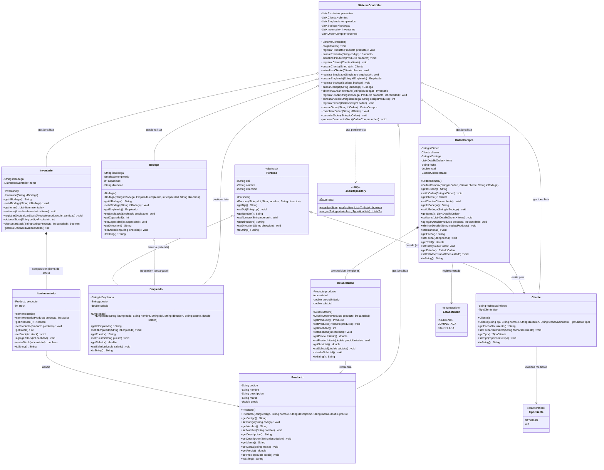

# Diagrama de Clases UML y Fundamentación de Programación Orientada a Objetos

## 1. Introducción

Este documento presenta el diseño orientado a objetos del **Sistema de Gestión de Inventario y Ventas**. El modelo fue estructurado siguiendo los principios fundamentales de la Programación Orientada a Objetos (abstracción, encapsulamiento, herencia y polimorfismo), así como las relaciones estructurales de asociación, agregación, composición y dependencia entre las capas de modelo (`com.sistema.model`), persistencia (`com.sistema.persistence`), controlador (`com.sistema.controller`) y presentación (`com.sistema.view`).

---

## 2. Diagrama de Clases UML

El siguiente diagrama en notación UML representa fielmente las clases, enumeraciones, atributos, métodos y relaciones implementadas en el código fuente del proyecto:

---

## 3. Justificación de los Principios POO Implementados

### 3.1. Abstracción
La abstracción consiste en capturar las características esenciales de un objeto omitiendo los detalles irrelevantes para el dominio del problema.
- **Clase abstracta `Persona`**: Declara los atributos comunes a todo ser humano en el sistema (`dpi`, `nombre`, `direccion`). Se define explícitamente como `abstract` para evitar que se puedan instanciar personas genéricas en la memoria; toda persona debe ser concretamente un `Cliente` o un `Empleado`.
- **Entidades del dominio**: `Producto`, `Bodega`, `Inventario`, `ItemInventario`, `OrdenCompra` y `DetalleOrden` modelan con precisión los elementos de la operación logística y comercial.

### 3.2. Herencia
La herencia permite la reutilización de código y la especialización de comportamientos a partir de una clase base común.
- **Subclase `Cliente` (`extends Persona`)**: Hereda `dpi`, `nombre` y `direccion` de `Persona`, invocando al constructor base mediante `super(dpi, nombre, direccion)`. Añade sus propios atributos: `fechaNacimiento` y el tipo comercial `TipoCliente`.
- **Subclase `Empleado` (`extends Persona`)**: Reutiliza la identificación civil de `Persona` e incorpora los atributos laborales requeridos por la nómina de la empresa: `idEmpleado`, `puesto` y `salario`.

### 3.3. Encapsulamiento
El encapsulamiento protege el estado interno de las clases frente a modificaciones no autorizadas o inconsistentes desde el exterior.
- **Modificadores de visibilidad**:
  - `private`: Todos los atributos de las clases concretas están declarados como `private`, restringiendo su manipulación directa.
  - `protected`: Los atributos de la clase abstracta `Persona` son `protected` para permitir acceso directo por herencia a sus clases hijas (`Cliente` y `Empleado`), manteniendo el ocultamiento hacia el exterior.
- **Métodos accesores y mutadores (Getters y Setters)**: Proveen acceso regulado a cada variable.
- **Invariantes y autocalculo**:
  - En `DetalleOrden`, los métodos `setCantidad(int)` y `setPrecioUnitario(double)` recalculan de manera privada el subtotal con `calcularSubtotal()`.
  - En `OrdenCompra`, `agregarDetalle()` y `eliminarDetalle()` recalculan automáticamente el gran total de la venta con `calcularTotal()`.
  - En `ItemInventario`, `restarStock(int cantidad)` valida internamente que `cantidad <= this.stock` antes de restar, devolviendo `false` si se intenta descontar más de lo existente.

### 3.4. Polimorfismo
El polimorfismo permite que distintos objetos respondan al mismo mensaje de forma especializada.
- **Polimorfismo por sobrescritura (`@Override`)**:
  - Las clases del modelo sobrescriben el método `toString()` de `java.lang.Object`.
  - Por ejemplo, `Cliente.toString()` muestra el nombre, el tipo y el DPI, mientras que `Empleado.toString()` muestra el código de empleado, nombre y puesto.
  - Cuando los componentes Swing (`JComboBox<T>`) renderizan estas clases, invocan polimórficamente `toString()` en tiempo de ejecución para mostrar el texto adecuado sin acoplar la vista.
- **Polimorfismo paramétrico (Genéricos)**:
  - `JsonRepository` utiliza el parámetro genérico `<T>` en `guardar(String, List<T>)` y `cargar(String, Type)`. Un solo método es capaz de procesar listas de cualquier clase del dominio.

### 3.5. Relaciones Estructurales: Composición vs. Agregación

#### Composición (Relación Fuerte "Todo/Parte")
En la composición, el ciclo de vida del objeto contenido depende del ciclo de vida del contenedor. Si el contenedor se destruye, los componentes asociados dejan de tener sentido y desaparecen.
1. **`OrdenCompra` y `DetalleOrden`**:
   - Una orden de compra se compone de una lista de `DetalleOrden`. Los renglones de detalle pertenecen exclusivamente a esa orden de compra; no existen de forma autónoma.
2. **`Inventario` y `ItemInventario`**:
   - Cada registro de `Inventario` administra la lista de existencias `ItemInventario` de una sede física específica. Las existencias en esa bodega dependen totalmente del inventario de dicha sede.

#### Agregación (Relación Débil "Todo/Parte")
En la agregación, los objetos relacionados tienen ciclos de vida independientes. Si el objeto contenedor se destruye, el objeto contenido continúa existiendo.
1. **`Bodega` y `Empleado`**:
   - La clase `Bodega` tiene un atributo `private Empleado empleado;` que representa al encargado. El empleado existe en la nómina de la empresa antes de la creación de la bodega, y si la bodega se cierra o se elimina, el empleado permanece registrado en el sistema.
2. **`OrdenCompra` y `Cliente`**:
   - La orden asocia a un `Cliente` para la facturación, pero el cliente existe de manera independiente en el directorio comercial.
3. **`DetalleOrden` / `ItemInventario` y `Producto`**:
   - Tanto los renglones de una venta como los registros de inventario referencian instancias de `Producto`, pero la entidad `Producto` existe de forma autónoma en el catálogo general.
