# Diagrama de Clases UML y Especificación POO

**Proyecto**: Sistema de Gestión de Inventario y Facturación  
**Curso**: Programación Orientada a Objetos  
**Arquitectura**: Modelo - Vista - Controlador (MVC)  
**Lenguaje**: Java SE 21 (Estándar LTS)  
**Integrantes**:
* Pedro Andrés Chajón
* Sharon Guacamaya (`sharonley112`)
* Dannii Pirir (`dannii-12`)

---

## 1. Diagrama de Clases UML del Sistema

El siguiente diagrama modela la arquitectura completa del sistema, dividida en sus capas de **Modelo** (`com.sistema.model`), **Persistencia** (`com.sistema.persistence`) y **Controlador** (`com.sistema.controller`).

```mermaid
classDiagram
    direction TB

    %% ==========================================
    %% JERARQUIA DE PERSONAS
    %% ==========================================
    class Persona {
        <<abstract>>
        #String dpi
        #String nombre
        #String direccion
        +Persona()
        +Persona(String dpi, String nombre, String direccion)
        +getDpi() String
        +setDpi(String dpi) void
        +getNombre() String
        +setNombre(String nombre) void
        +getDireccion() String
        +setDireccion(String direccion) void
        +toString() String
    }

    class Cliente {
        -String fechaNacimiento
        -TipoCliente tipo
        +Cliente()
        +Cliente(String dpi, String nombre, String direccion, String fechaNacimiento, TipoCliente tipo)
        +getFechaNacimiento() String
        +setFechaNacimiento(String fechaNacimiento) void
        +getTipo() TipoCliente
        +setTipo(TipoCliente tipo) void
        +toString() String
    }

    class TipoCliente {
        <<enumeration>>
        REGULAR
        VIP
    }

    class Empleado {
        -String idEmpleado
        -String puesto
        -double salario
        +Empleado()
        +Empleado(String idEmpleado, String nombre, String dpi, String direccion, String puesto, double salario)
        +getIdEmpleado() String
        +setIdEmpleado(String idEmpleado) void
        +getPuesto() String
        +setPuesto(String puesto) void
        +getSalario() double
        +setSalario(double salario) void
        +toString() String
    }

    Persona <|-- Cliente : herencia (extends)
    Persona <|-- Empleado : herencia (extends)
    Cliente --> TipoCliente : asocia tipo

    %% ==========================================
    %% CATALOGO, BODEGAS E INVENTARIO
    %% ==========================================
    class Producto {
        -String codigo
        -String nombre
        -String descripcion
        -String marca
        -double precio
        +Producto()
        +Producto(String codigo, String nombre, String descripcion, String marca, double precio)
        +getCodigo() String
        +setCodigo(String codigo) void
        +getNombre() String
        +setNombre(String nombre) void
        +getDescripcion() String
        +setDescripcion(String descripcion) void
        +getMarca() String
        +setMarca(String marca) void
        +getPrecio() double
        +setPrecio(double precio) void
        +toString() String
    }

    class Bodega {
        -String idBodega
        -String nombre
        -String direccion
        -int capacidad
        -Empleado encargado
        +Bodega()
        +Bodega(String idBodega, String nombre, String direccion, int capacidad, Empleado encargado)
        +getIdBodega() String
        +setIdBodega(String idBodega) void
        +getNombre() String
        +setNombre(String nombre) void
        +getDireccion() String
        +setDireccion(String direccion) void
        +getCapacidad() int
        +setCapacidad(int capacidad) void
        +getEncargado() Empleado
        +setEncargado(Empleado encargado) void
        +toString() String
    }

    class ItemInventario {
        -Producto producto
        -int stock
        +ItemInventario()
        +ItemInventario(Producto producto, int stock)
        +getProducto() Producto
        +setProducto(Producto producto) void
        +getStock() int
        +setStock(int stock) void
        +agregarStock(int cantidad) void
        +restarStock(int cantidad) boolean
        +toString() String
    }

    class Inventario {
        -String idBodega
        -List~ItemInventario~ items
        +Inventario()
        +Inventario(String idBodega)
        +getIdBodega() String
        +setIdBodega(String idBodega) void
        +getItems() List~ItemInventario~
        +setItems(List~ItemInventario~ items) void
        +registrarOActualizarStock(Producto producto, int cantidad) void
        +descontarStock(String codigoProducto, int cantidad) boolean
        +obtenerStock(String codigoProducto) int
        +getTotalUnidadesAlmacenadas() int
    }

    Bodega o-- Empleado : agregacion (encargado)
    Inventario *-- ItemInventario : composicion (existencias)
    ItemInventario --> Producto : referencia producto
    Inventario ..> Bodega : vinculacion por idBodega

    %% ==========================================
    %% VENTAS Y FACTURACION
    %% ==========================================
    class DetalleOrden {
        -Producto producto
        -int cantidad
        -double precioUnitario
        -double subtotal
        +DetalleOrden()
        +DetalleOrden(Producto producto, int cantidad)
        +getProducto() Producto
        +setProducto(Producto producto) void
        +getCantidad() int
        +setCantidad(int cantidad) void
        +getPrecioUnitario() double
        +setPrecioUnitario(double precioUnitario) void
        +getSubtotal() double
        -calcularSubtotal() void
        +toString() String
    }

    class EstadoOrden {
        <<enumeration>>
        PENDIENTE
        COMPLETADA
        CANCELADA
    }

    class OrdenCompra {
        -String idOrden
        -Cliente cliente
        -String idBodega
        -List~DetalleOrden~ items
        -String fecha
        -double total
        -EstadoOrden estado
        +OrdenCompra()
        +OrdenCompra(String idOrden, Cliente cliente, String idBodega)
        +getIdOrden() String
        +setIdOrden(String idOrden) void
        +getCliente() Cliente
        +setCliente(Cliente cliente) void
        +getIdBodega() String
        +setIdBodega(String idBodega) void
        +getItems() List~DetalleOrden~
        +setItems(List~DetalleOrden~ items) void
        +agregarDetalle(Producto producto, int cantidad) void
        +eliminarDetalle(String codigoProducto) void
        +calcularTotal() void
        +getFecha() String
        +setFecha(String fecha) void
        +getTotal() double
        +setTotal(double total) void
        +getEstado() EstadoOrden
        +setEstado(EstadoOrden estado) void
        +toString() String
    }

    OrdenCompra *-- DetalleOrden : composicion (renglones)
    OrdenCompra o-- Cliente : agregacion (facturado a)
    OrdenCompra --> EstadoOrden : estado transaccional
    DetalleOrden --> Producto : referencia producto

    %% ==========================================
    %% CONTROLADOR Y PERSISTENCIA
    %% ==========================================
    class JsonRepository {
        <<utility>>
        -Gson gson$
        +guardar(String rutaArchivo, List~T~ lista)$ boolean
        +cargar(String rutaArchivo, Type tipoLista)$ List~T~
    }

    class SistemaController {
        -List~Producto~ productos
        -List~Cliente~ clientes
        -List~Empleado~ empleados
        -List~Bodega~ bodegas
        -List~Inventario~ inventarios
        -List~OrdenCompra~ ordenes
        +SistemaController()
        +cargarDatos() void
        +registrarProducto(Producto p) void
        +buscarProducto(String codigo) Producto
        +actualizarProducto(Producto p) void
        +registrarCliente(Cliente c) void
        +buscarCliente(String dpi) Cliente
        +actualizarCliente(Cliente c) void
        +registrarEmpleado(Empleado e) void
        +buscarEmpleado(String idEmpleado) Empleado
        +registrarBodega(Bodega b) void
        +buscarBodega(String idBodega) Bodega
        +obtenerOCrearInventario(String idBodega) Inventario
        +registrarStock(String idBodega, Producto p, int cant) void
        +consultarStock(String idBodega, String codProd) int
        +registrarOrden(OrdenCompra orden) void
        +buscarOrden(String idOrden) OrdenCompra
        +completarOrden(String idOrden) void
        +cancelarOrden(String idOrden) void
        -procesarDescuentoStock(OrdenCompra orden) void
    }

    SistemaController ..> JsonRepository : I/O persistencia
    SistemaController o-- Producto : gestiona lista
    SistemaController o-- Cliente : gestiona lista
    SistemaController o-- Empleado : gestiona lista
    SistemaController o-- Bodega : gestiona lista
    SistemaController o-- Inventario : gestiona lista
    SistemaController o-- OrdenCompra : gestiona lista
```



---

## 2. Diccionario Técnico de Clases y Atributos

A continuación se detalla la especificación de datos de cada entidad del dominio:

### 2.1. Paquete `com.sistema.model`

#### Clase Abstracta `Persona`
Base conceptual que agrupa los atributos de identidad civil. No instanciable directamente.
| Modificador | Atributo | Tipo de Dato | Invariante / Regla de Validación |
| :--- | :--- | :--- | :--- |
| `protected` | `dpi` | `String` | Cadena alfanumérica de 13 dígitos. Identificador único de identificación civil. |
| `protected` | `nombre` | `String` | Nombre completo de la persona. No nulo ni vacío. |
| `protected` | `direccion` | `String` | Dirección física de residencia o fiscal. |

#### Clase `Cliente extends Persona`
Representa al comprador que realiza órdenes comerciales.
| Modificador | Atributo | Tipo de Dato | Invariante / Regla de Validación |
| :--- | :--- | :--- | :--- |
| `private` | `fechaNacimiento` | `String` | Formato ISO `AAAA-MM-DD`. Debe representar una fecha válida. |
| `private` | `tipo` | `TipoCliente` | Enum tipado: `TipoCliente.REGULAR` o `TipoCliente.VIP`. |

#### Clase `Empleado extends Persona`
Representa a los colaboradores de la empresa que administran las bodegas físicas.
| Modificador | Atributo | Tipo de Dato | Invariante / Regla de Validación |
| :--- | :--- | :--- | :--- |
| `private` | `idEmpleado` | `String` | Código identificador empresarial único (ej. `EMP-01`). |
| `private` | `puesto` | `String` | Cargo desempeñado (ej. `Supervisor de Bodega`). |
| `private` | `salario` | `double` | Valor monetario en Quetzales. Invariante: $\text{salario} > 0.0$. |

#### Clase `Producto`
Artículos comercializados en el catálogo general.
| Modificador | Atributo | Tipo de Dato | Invariante / Regla de Validación |
| :--- | :--- | :--- | :--- |
| `private` | `codigo` | `String` | Clave alfanumérica primaria única (ej. `PROD-01`). |
| `private` | `nombre` | `String` | Nombre comercial del artículo. |
| `private` | `descripcion` | `String` | Detalle técnico y especificaciones. |
| `private` | `marca` | `String` | Fabricante o marca del bien. |
| `private` | `precio` | `double` | Precio unitario de venta. Invariante: $\text{precio} > 0.0$. |

#### Clase `Bodega`
Sede física de almacenamiento.
| Modificador | Atributo | Tipo de Dato | Invariante / Regla de Validación |
| :--- | :--- | :--- | :--- |
| `private` | `idBodega` | `String` | Código identificador de la sede (ej. `BOD-01`). |
| `private` | `nombre` | `String` | Nombre descriptivo de la sucursal. |
| `private` | `direccion` | `String` | Ubicación geográfica. |
| `private` | `capacidad` | `int` | Capacidad máxima en unidades físicas totales. $\text{capacidad} > 0$. |
| `private` | `encargado` | `Empleado` | Referencia al empleado responsable (Agregación débil). |

#### Clase `ItemInventario`
Renglón de stock que vincula un producto con su existencia en una bodega concreta.
| Modificador | Atributo | Tipo de Dato | Invariante / Regla de Validación |
| :--- | :--- | :--- | :--- |
| `private` | `producto` | `Producto` | Referencia al producto del catálogo. |
| `private` | `stock` | `int` | Cantidad física en existencia. Invariante: $\text{stock} \ge 0$. |

#### Clase `Inventario`
Colección de existencias asociadas a una bodega física.
| Modificador | Atributo | Tipo de Dato | Invariante / Regla de Validación |
| :--- | :--- | :--- | :--- |
| `private` | `idBodega` | `String` | Llave foránea vinculada al `idBodega` de la sede. |
| `private` | `items` | `List<ItemInventario>` | Lista de renglones de existencias (Composición fuerte). |

#### Clase `DetalleOrden`
Línea individual de compra dentro de una orden de facturación.
| Modificador | Atributo | Tipo de Dato | Invariante / Regla de Validación |
| :--- | :--- | :--- | :--- |
| `private` | `producto` | `Producto` | Objeto del producto solicitado. |
| `private` | `cantidad` | `int` | Unidades a comprar. $\text{cantidad} > 0$. |
| `private` | `precioUnitario` | `double` | Precio congelado al momento de agregar al carrito. |
| `private` | `subtotal` | `double` | Autocalculado: $\text{subtotal} = \text{cantidad} \times \text{precioUnitario}$. |

#### Clase `OrdenCompra`
Cabecera transaccional de venta.
| Modificador | Atributo | Tipo de Dato | Invariante / Regla de Validación |
| :--- | :--- | :--- | :--- |
| `private` | `idOrden` | `String` | Número de comprobante único (ej. `ORD-01`). |
| `private` | `cliente` | `Cliente` | Comprador titular de la venta. |
| `private` | `idBodega` | `String` | Bodega de despacho de donde se descuenta el stock. |
| `private` | `items` | `List<DetalleOrden>` | Líneas de detalle (Composición fuerte). |
| `private` | `fecha` | `String` | Timestamp de registro `AAAA-MM-DD HH:MM:SS`. |
| `private` | `total` | `double` | Autocalculado: $\sum \text{subtotales}$. |
| `private` | `estado` | `EstadoOrden` | Enum: `PENDIENTE`, `COMPLETADA` o `CANCELADA`. |

---

## 3. Justificación de Principios POO en el Código

### 3.1. Abstracción
Se extrajeron las propiedades esenciales del negocio eliminando redundancias:
* **`Persona.java` como `abstract class`**: En el negocio no se pueden instanciar entidades genéricas `Persona`; una persona física siempre debe asumir el rol de cliente comercial o empleado de nómina.
* **Separación de capas**: El modelo (`com.sistema.model`) es completamente independiente de Swing y de Gson. Ninguna clase del modelo importa librerías gráficas (`javax.swing.*`) ni de persistencia.

### 3.2. Herencia
Reutilización de atributos y métodos mediante especialización jerárquica:
```java
// Constructor en Cliente.java invocando super()
public Cliente(String dpi, String nombre, String direccion, String fechaNacimiento, TipoCliente tipo) {
    super(dpi, nombre, direccion); // Inicializa los atributos de Persona
    this.fechaNacimiento = fechaNacimiento;
    this.tipo = tipo;
}
```
* **Ventaja técnica**: Si la empresa añade un nuevo tipo de actor en el futuro (ej. `Proveedor`), simplemente extiende `Persona` heredando la validación de `dpi`, `nombre` y `direccion` sin duplicar código.

### 3.3. Encapsulamiento
Protección estricta del estado interno mediante métodos de acceso controlados y recálculo automático de invariantes:
* Todos los atributos de clase son `private` (o `protected` en la jerarquía de `Persona`).
* **Autocalculo defensivo en `DetalleOrden.java`**:
  ```java
  public void setCantidad(int cantidad) {
      this.cantidad = cantidad;
      this.calcularSubtotal(); // Impide que el subtotal quede desincronizado
  }
  private void calcularSubtotal() {
      this.subtotal = this.cantidad * this.precioUnitario;
  }
  ```
* **Protección de stock en `ItemInventario.java`**:
  ```java
  public boolean restarStock(int cantidad) {
      if (cantidad <= this.stock) {
          this.stock -= cantidad;
          return true;
      }
      return false; // Rechaza el descuento sin alterar el valor si la cantidad es mayor
  }
  ```

### 3.4. Polimorfismo
Capacidad de responder a un mismo mensaje de forma especializada según la instancia:
1. **Sobrescritura polimórfica de `toString()`**:
   * Las clases `Cliente`, `Empleado`, `Producto` y `Bodega` sobrescriben `toString()`.
   * En las vistas (`JComboBox<Cliente>`, `JComboBox<Producto>`), Swing invoca internamente `toString()` en tiempo de ejecución. Esto permite desacoplar los componentes gráficos del modelo, ya que el combo muestra automáticamente la representación formateada de cada objeto sin necesidad de convertidores manuales.
2. **Polimorfismo Paramétrico (Genéricos en `JsonRepository.java`)**:
   * Se utiliza el parámetro de tipo `<T>`:
     ```java
     public static <T> boolean guardar(String rutaArchivo, List<T> lista)
     public static <T> List<T> cargar(String rutaArchivo, Type tipoLista)
     ```
   * Un único bloque de código gestiona la persistencia de productos, clientes, empleados, bodegas, existencias y órdenes de compra con seguridad de tipos en tiempo de compilación.

---

## 4. Matriz de Relaciones Estructurales

| Relación | Origen ➔ Destino | Tipo | Multiplicidad | Justificación Arquitectónica |
| :--- | :--- | :--- | :---: | :--- |
| **Herencia** | `Cliente` ➔ `Persona`<br>`Empleado` ➔ `Persona` | Generalización | $N \rightarrow 1$ | Especialización del concepto persona para clientes y trabajadores. |
| **Composición** | `OrdenCompra` ➔ `DetalleOrden` | Fuerte (`*--`) | $1 \rightarrow 1..*$ | Los renglones de una orden no tienen ciclo de vida independiente; pertenecen exclusivamente a su orden de compra. |
| **Composición** | `Inventario` ➔ `ItemInventario` | Fuerte (`*--`) | $1 \rightarrow 0..*$ | Las existencias registradas en una sede física solo existen dentro del inventario de dicha bodega. |
| **Agregación** | `Bodega` ➔ `Empleado` | Débil (`o--`) | $0..* \rightarrow 1$ | La bodega asocia a un empleado encargado, pero el empleado existe en la nómina con independencia de si la bodega cierra. |
| **Agregación** | `OrdenCompra` ➔ `Cliente` | Débil (`o--`) | $0..* \rightarrow 1$ | La orden se factura a nombre de un cliente, pero el cliente permanece en el directorio general. |
| **Asociación** | `DetalleOrden` ➔ `Producto`<br>`ItemInventario` ➔ `Producto` | Referencia (`-->`) | $0..* \rightarrow 1$ | Las transacciones e inventarios apuntan a los datos del catálogo central de productos. |
| **Dependencia** | `SistemaController` ➔ `JsonRepository` | Uso (`..>`) | $1 \rightarrow 1$ | El controlador invoca los métodos estáticos de persistencia para guardar y leer los datos de disco. |
