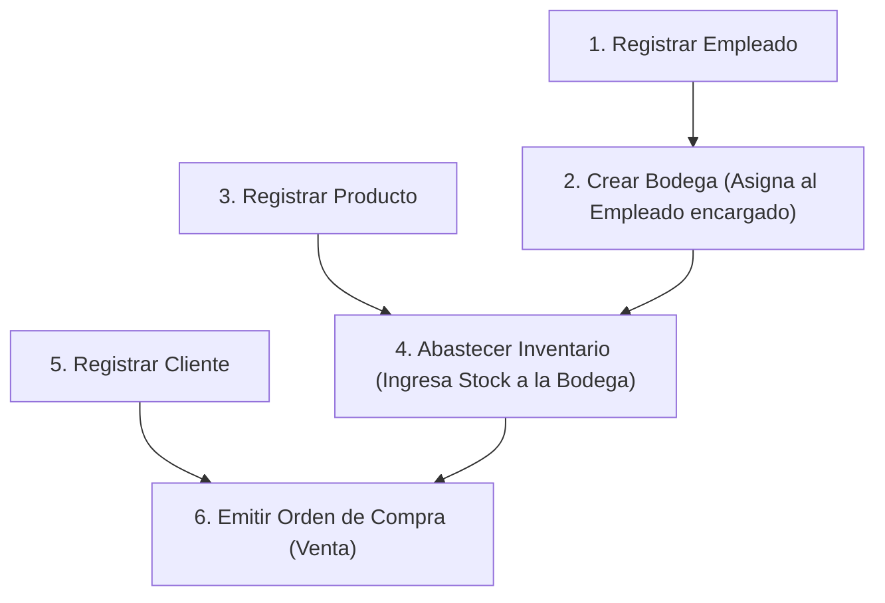
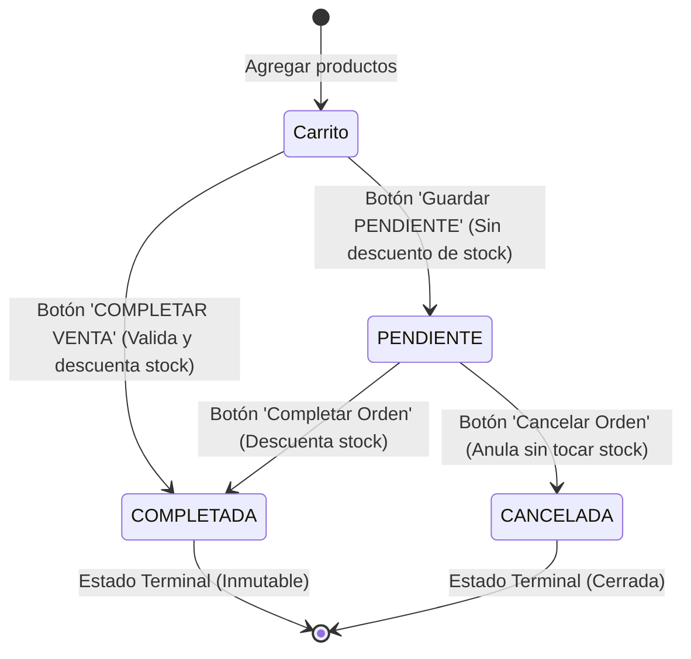

# Manual de Usuario y Guía Operativa

**Sistema**: Control de Inventario y Ventas  
**Tipo**: Aplicación de Escritorio (Java Swing con FlatLaf)  
**Versión**: 1.0.0 LTS  

---

## 1. Anatomía y Navegación de la Interfaz

La aplicación se presenta en una ventana principal de **1200 x 750 píxeles** diseñada para una operación ágil mediante teclado y ratón:

```text
┌───────────────────────────┬────────────────────────────────────────────────────────┐
│  SISTEMA DE VENTAS        │  MÓDULO SELECCIONADO                                  │
│  Control de Inventario    │  Subtítulo descriptivo de la acción                   │
├───────────────────────────┼────────────────────────────┬───────────────────────────┤
│ [📊] Dashboard            │                            │                           │
│ [📦] Productos            │    PANEL DE FORMULARIO     │     TABLA DE REGISTROS    │
│ [👥] Clientes             │    (Cajas de texto,        │  (Visualización de datos, │
│ [👔] Empleados            │     selectores desplegables│   buscador en tiempo real │
│ [🏢] Bodegas              │     y botones de acción)   │   y selección de filas)   │
│ [📋] Inventario           │                            │                           │
│ [🛒] Órdenes de Compra    │                            │                           │
└───────────────────────────┴────────────────────────────┴───────────────────────────┘
```

### Elementos Globales:
1. **Menú Lateral (Izquierda)**: Permite alternar entre los 7 módulos del sistema. El módulo activo se ilumina en color gris azulado (`#334155`).
2. **Formulario de Entrada (Centro-Izquierda)**: Donde se introducen o editan los registros. Los campos obligatorios están marcados y validados.
3. **Tabla Dinámica con Buscador (Derecha)**: Muestra la información almacenada en tiempo real. Escribir en la barra de búsqueda y presionar **Buscar** filtra los datos sin recargar la pantalla.

---

## 2. Flujo Lógico de Carga Inicial (Puesta en Marcha)

Para que el sistema opere con coherencia y las listas desplegables muestren opciones válidas, se debe seguir este orden de registro obligatorio:



---

## 3. Especificación Detallada por Módulo

---

### 3.1. Dashboard (Panel General)
Pantalla de resumen ejecutivo con actualización reactiva tras cada venta:
* **Tarjetas Superiores**:
  * **PRODUCTOS EN CATÁLOGO**: Cantidad de artículos distintos dados de alta.
  * **CLIENTES REGISTRADOS**: Total de compradores en la base de datos.
  * **BODEGAS HABILITADAS**: Número de sedes físicas activas.
  * **INGRESOS COMPLETADOS**: Suma monetaria en Quetzales (`Q`) únicamente de ventas finalizadas con estado `COMPLETADA`.
* **Tabla de Ocupación de Bodegas**: Monitorea el espacio ocupado respecto al límite físico (ej. `45 / 500 uds`), indicando el encargado y las unidades libres restantes.
* **Tabla de Últimas Transacciones**: Lista las 10 ventas más recientes con su cliente, monto y estado actual.

---

### 3.2. Catálogo de Productos
Administra los bienes que comercializa la empresa.

| Campo | Tipo / Formato | Regla de Validación | Descripción |
| :--- | :--- | :--- | :--- |
| **Código** | Alfanumérico (ej. `PROD-01`) | Obligatorio, Único | Identificador del producto. No se puede modificar una vez guardado. |
| **Nombre** | Texto libre | Obligatorio | Nombre comercial del artículo (ej. `Monitor 24"`). |
| **Marca** | Texto libre | Obligatorio | Fabricante (ej. `Dell`, `Samsung`). |
| **Precio (Q)** | Numérico decimal | Obligatorio, $> 0.0$ | Precio de venta. Usar punto para decimales (ej. `1450.50`). |
| **Descripción**| Texto multilínea | Opcional | Especificaciones técnicas o notas del artículo. |

* **Botón Guardar**: Si el código no existe, lo inserta; si ya existe y se seleccionó de la tabla, actualiza sus datos.
* **Botón Nuevo / Limpiar**: Borra el formulario y rehabilita la casilla de código para un nuevo ingreso.
* **Selección en Tabla**: Al hacer clic en un producto, sus datos se cargan en el formulario para edición inmediata.

---

### 3.3. Directorio de Clientes
Mantiene la base de datos de compradores.

| Campo | Tipo / Formato | Regla de Validación | Descripción |
| :--- | :--- | :--- | :--- |
| **DPI** | 13 dígitos numéricos | Obligatorio, Único | Identificación civil del cliente (ej. `2541896320101`). |
| **Nombre** | Texto libre | Obligatorio | Nombre y apellidos completos. |
| **Dirección** | Texto libre | Obligatorio | Domicilio para entregas o facturación. |
| **Fecha Nac.**| `AAAA-MM-DD` | Obligatorio | Fecha de nacimiento (ej. `1992-05-14`). |
| **Tipo** | Selector (Combo) | Obligatorio | Categoría comercial: `REGULAR` o `VIP`. |

---

### 3.4. Nómina de Empleados
Registra a los colaboradores de la empresa que pueden ser designados como encargados de sucursales.

| Campo | Tipo / Formato | Regla de Validación | Descripción |
| :--- | :--- | :--- | :--- |
| **ID Empleado**| Alfanumérico (ej. `EMP-01`) | Obligatorio, Único | Código de nómina del trabajador. |
| **Nombre** | Texto libre | Obligatorio | Nombre completo del colaborador. |
| **DPI** | 13 dígitos numéricos | Obligatorio, Único | Documento civil no duplicable en la nómina. |
| **Dirección** | Texto libre | Obligatorio | Domicilio residencial. |
| **Puesto** | Texto libre | Obligatorio | Cargo (ej. `Encargado de Bodega Central`). |
| **Salario (Q)**| Numérico decimal | Obligatorio, $> 0.0$ | Sueldo mensual en Quetzales (ej. `4500.00`). |

---

### 3.5. Sedes y Bodegas
Configura las instalaciones físicas de almacenamiento.

| Campo | Tipo / Formato | Regla de Validación | Descripción |
| :--- | :--- | :--- | :--- |
| **ID Bodega** | Alfanumérico (ej. `BOD-01`) | Obligatorio, Único | Código de la sede física. |
| **Nombre** | Texto libre | Obligatorio | Nombre de la sucursal (ej. `Bodega Roosevelt`). |
| **Dirección** | Texto libre | Obligatorio | Ubicación física del almacén. |
| **Capacidad** | Entero positivo | Obligatorio, $> 0$ | Total de unidades físicas que soporta el local. |
| **Encargado** | Selector desplegable | Obligatorio | Empleado responsable seleccionado de la nómina. |

---

### 3.6. Control de Inventario (Entrada de Existencias)
Permite ingresar lotes de productos a una bodega específica.

1. **Selector de Bodega**: Al elegir una bodega, la barra superior muestra el estado de ocupación:
   $$\text{Capacidad: } 500 \text{ uds} \quad \vert \quad \text{Ocupado: } 120 \text{ uds} \quad \vert \quad \text{Libre: } 380 \text{ uds}$$
2. **Selector de Producto**: Muestra el catálogo de artículos registrados.
3. **Cantidad a Ingresar**: Número entero mayor a cero.
4. **Validación de Límite**:
   * Si $\text{Cantidad} \le \text{Espacio Libre}$, el sistema añade el stock y actualiza la tabla inferior.
   * Si $\text{Cantidad} > \text{Espacio Libre}$, se detiene la acción y una alerta indica cuántas unidades caben como máximo.

---

### 3.7. Órdenes de Compra y Facturación
Módulo comercial dividido en dos pestañas:

#### Pestaña 1: "Nueva Orden de Compra"
* **Encabezado**:
  * **No. Orden**: Código de factura (ej. `ORD-01`).
  * **Cliente**: Selector del comprador.
  * **Bodega**: Sede de donde saldrá la mercadería.
* **Carrito de Compras**:
  * Al seleccionar un producto, el sistema muestra el indicador: `Stock disponible en bodega: X uds`.
  * Escribe la cantidad y presiona **Agregar Producto**. Se añade una fila a la tabla con el subtotal ($P \times Q$).
  * Para remover un artículo del carrito, selecciónalo en la tabla y presiona **Quitar Seleccionado**.
* **Opciones de Cierre**:
  * **Guardar PENDIENTE**: Guarda el pedido en espera. **No descuenta inventario**. Útil para cotizaciones.
  * **COMPLETAR VENTA**: Valida que todos los productos tengan existencias suficientes, descuenta el stock de la bodega automáticamente y registra la venta como `COMPLETADA`.

#### Pestaña 2: "Historial de Órdenes"
* Muestra todas las transacciones históricas.
* Al hacer clic en una orden, la tabla derecha despliega el detalle de los productos facturados.
* **Completar Orden Seleccionada**: Permite tomar una orden que estaba en espera (`PENDIENTE`), verificar existencias y pasarla a `COMPLETADA`.
* **Cancelar Orden**: Anula una orden en espera (`PENDIENTE`). Si la orden ya estaba `COMPLETADA`, el sistema prohíbe la cancelación.

---

## 4. Ciclo de Vida y Estados de una Orden de Compra



---

## 5. Guía Paso a Paso de Casos de Uso Reales

### Caso 1: Venta exitosa con descuento automático
1. Ve a **Órdenes de Compra** ➔ Pestaña *Nueva Orden*.
2. Escribe el número `ORD-101`.
3. Selecciona a la clienta `Ana Morales` y la bodega `BOD-01`.
4. Elige `Laptop HP Pavilion`. El indicador mostrará `Stock en bodega: 10 uds`.
5. Escribe cantidad `3` y haz clic en **Agregar Producto**. El carrito mostrará `Subtotal: Q 15,600.00` y `TOTAL: Q 15,600.00`.
6. Haz clic en el botón verde **COMPLETAR VENTA**.
7. **Resultado**: El sistema emite confirmación. Al ir a **Inventario**, la existencia de laptops en `BOD-01` habrá bajado de 10 a **7 unidades**. En el **Dashboard**, los ingresos habrán aumentado en `Q 15,600.00`.

### Caso 2: Intento de venta con stock insuficiente
1. En una nueva orden, intenta agregar `15` unidades de la Laptop cuando solo quedan `7`.
2. Presiona **COMPLETAR VENTA**.
3. **Resultado**: El sistema arrojará la alerta:  
   *"Stock insuficiente en bodega BOD-01 para el producto: Laptop HP Pavilion. Disponible: 7, Solicitado: 15"*.
4. **Garantía de Integridad**: La orden no se emite y el inventario no sufre ningún descuento.

---

## 6. Catálogo de Mensajes del Sistema y Solución de Problemas

| Mensaje en Diálogo | Causa Técnica | Solución Inmediata |
| :--- | :--- | :--- |
| *"El precio debe ser mayor a 0"* | Se introdujo un valor negativo o cero en el precio del producto. | Ingrese un precio positivo mayor a cero (ej. `125.00`). |
| *"El salario debe ser mayor a 0"* | Se intentó registrar un empleado con salario $\le 0.0$. | Especifique un sueldo mensual válido en Quetzales. |
| *"La capacidad debe ser mayor a 0"* | Se ingresó una capacidad nula o negativa para una bodega. | Defina un número entero positivo de unidades físicas de almacenamiento. |
| *"Debe ser un número válido"* | Se introdujeron letras, símbolos o espacios en campos numéricos. | Escriba solo dígitos numéricos. Para decimales use punto `.`. |
| *"Ya existe un producto con el código..."* | Violación de clave primaria en el catálogo. | Escriba un código diferente o seleccione la fila en la tabla para modificarlo. |
| *"Ya existe un cliente con el DPI..."* | Intento de registrar un DPI ya existente. | Verifique el número de DPI o consulte la tabla de clientes. |
| *"Capacidad excedida en bodega..."* | Las existencias actuales más el nuevo lote superan el tope del almacén. | Consulte el espacio libre en la barra superior del módulo e ingrese un lote menor. |
| *"Stock insuficiente en bodega..."* | La cantidad solicitada en la orden supera el inventario físico disponible. | Reduzca la cantidad en la orden o abastezca inventario en la bodega antes de vender. |
| *"No se puede cancelar una orden que ya fue COMPLETADA"* | Regla de inmutabilidad comercial. | Las ventas completadas descuentan stock contable y no pueden anularse directamente. |
| *"Agregue al menos un producto a la orden"* | Se intentó guardar o completar una orden con el carrito vacío. | Seleccione un producto, ingrese la cantidad y presione **Agregar Producto**. |
